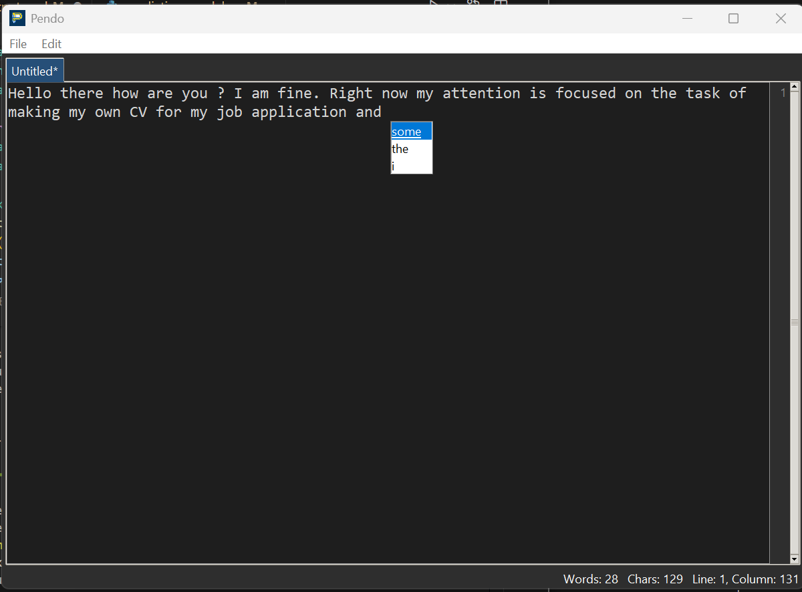

# Pendo Text Editor


Pendo is a modern, feature-rich text editor built with Python's Tkinter. It offers a clean, responsive user interface, real-time predictive text suggestions powered by a fine-tuned HuggingFace model, and essential editor functionalities for an enhanced typing experience.

## Features

*   **Modern UI:** Built with `tkinter.ttk` for a native look and feel, adapting to system light/dark themes on Windows.
*   **Tabbed Interface:** Edit multiple files concurrently with a tabbed document interface.
*   **Real-time Predictive Text:**
    *   Completes the word you are typing as gray inline text; press `Tab` to accept, keep typing to ignore.
    *   Suggestions always start with the letters already typed and keep their capitalization.
    *   A suggestion is shown only when the model is confident enough (`prediction.min_confidence`).
    *   When the following words are also likely, the suggestion continues past the current word (up to `prediction.max_phrase_words`). `Tab` accepts all of it, `Ctrl+Right` accepts one word at a time.
    *   The model, device, context size and debounce delay are set in `config.yaml`.
    *   Predictions run on a background thread so the UI stays responsive.
*   **Line Numbers Gutter:** Displays logical line numbers alongside the text area.
*   **Status Bar:** Provides real-time information including line, column, character, and word counts.
*   **Context Menu:** Right-click for quick access to common editing actions (Cut, Copy, Paste, Undo, Redo).
*   **Customizable Settings:** Adjust font family and size via a dedicated settings window.
*   **Custom Application Icon:** Features a unique P-shaped pencil icon.
*   **Keyboard Shortcuts:**
    *   `Ctrl+N`: New File
    *   `Ctrl+O`: Open File
    *   `Ctrl+S`: Save File
    *   `Ctrl+Shift+S`: Save File As...
    *   `Ctrl+W`: Close Current Tab
*   **Unsaved Changes Indicator:** An asterisk (`*`) appears in the tab title for modified files, with prompts to save before closing.

## Screenshot



## Installation

To get Pendo Text Editor up and running on your local machine, follow these steps:

1.  **Clone the repository:**
    ```bash
    git clone https://github.com/your-username/pendo-text-editor.git
    cd pendo-text-editor
    ```
    _(Replace `your-username/pendo-text-editor.git` with the actual repository URL)_

2.  **Create a virtual environment (recommended):**
    ```bash
    python -m venv venv
    ```

3.  **Activate the virtual environment:**
    *   **On Windows:**
        ```bash
        .\venv\Scripts\activate
        ```
    *   **On macOS/Linux:**
        ```bash
        source venv/bin/activate
        ```

4.  **Install dependencies:**
    ```bash
    pip install -r requirements.txt
    ```

## Usage

To run the Pendo Text Editor, execute the `main.py` file:

```bash
python src/main.py
```

## Configuration

Prediction is configured under `prediction:` in `config.yaml`. `model_path` accepts a HuggingFace Hub id or a model directory relative to the project root (for example `src/model_training/output/smollm2-135m-writing/final`).

## Learning from your typing

Each suggestion that is shown is recorded with its outcome (accepted, rejected, dismissed), the model's confidence, the word you actually typed, your typing pace at that moment, and what happened to the previous suggestion. The records stay on your machine in `~/.pendo/interactions.jsonl` and are the data later personalization is built on. Turn this off, move the file, or limit the stored context under `learning:` in `config.yaml`.

## Tests

```bash
python -m pytest
```

## Measuring prediction quality

The typing simulator replays a text one keystroke at a time and reports keystroke savings, suggestion precision and latency. Run it from the `src` directory:

```bash
python -m model_training.data_preprocessing.build_writing_corpus   # once: also writes held-out texts per genre
python -m evaluation.run_simulation model_training/data/writing/simulator/emails.txt
python -m evaluation.run_simulation model_training/data/writing/simulator/news.txt --model bekalebendong/pendo-distilgpt2-writing
```

## Model Training (Advanced)

The default model, [`bekalebendong/pendo-smollm2-135m-writing`](https://huggingface.co/bekalebendong/pendo-smollm2-135m-writing), is SmolLM2-135M fine-tuned on six kinds of writing (emails, blogs, fiction, academic abstracts, news, encyclopedia). A faster alternative is [`bekalebendong/pendo-distilgpt2-writing`](https://huggingface.co/bekalebendong/pendo-distilgpt2-writing). To reproduce them (a GPU is required), run from the `src` directory:

```bash
python -m model_training.data_preprocessing.build_writing_corpus   # builds data/writing/ (train, val, test)
CUDA_VISIBLE_DEVICES=0 python -m model_training.finetune.train --model HuggingFaceTB/SmolLM2-135M --run-name smollm2-135m-writing
python -m model_training.upload_to_hub.publish_writing_models      # optional: upload to your Hugging Face account
```

Trained models are written to `src/model_training/output/<run-name>/final`; point `prediction.model_path` at that directory to use one in the editor.

## Contributing

Feel free to fork the repository, make improvements, and submit pull requests. For major changes, please open an issue first to discuss what you would like to change.

## License

This project is licensed under the MIT License.